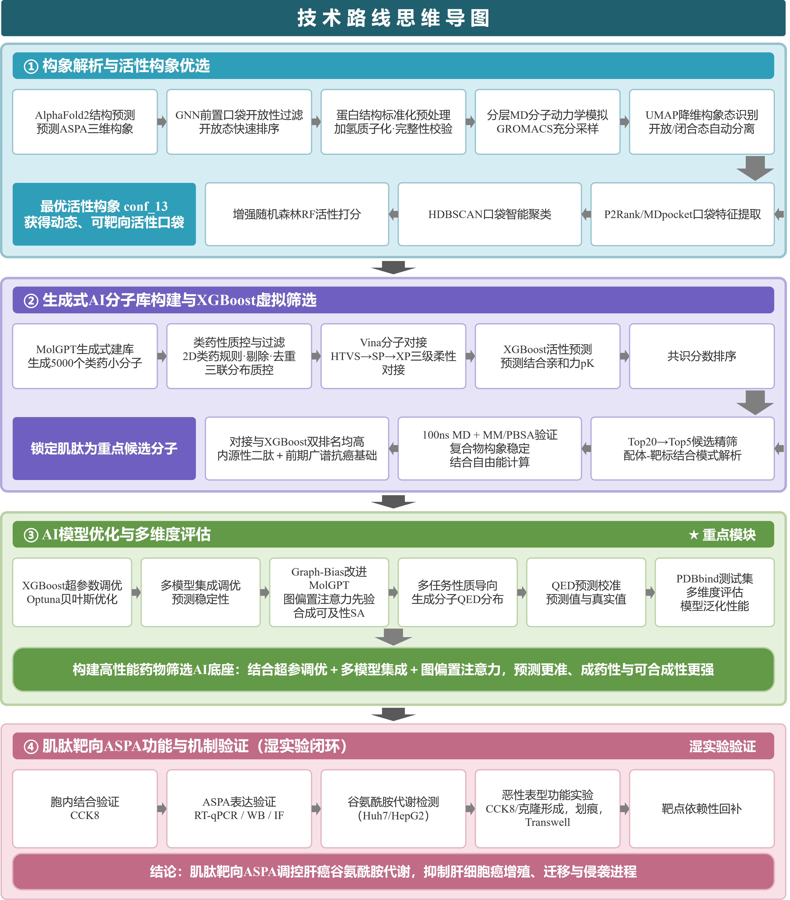

# ASPA 靶向小分子发现 

> 本提交包由两部分**合并**而成，两个子包内部代码与逻辑保持原样，
> 顶层 [predict.py](predict.py) 只负责**编排、交接核对与结果汇总**：
>
> - [任务1\_构象准备/](任务1_构象准备/)：从 ASPA 序列到最优活性构象（15 构象 RF 排名，Top1 = conf\_13）
> - [任务23\_虚拟筛选/](任务23_虚拟筛选/)：双路线虚拟筛选（路线A MolGPT 生成式 / 路线B yaTCM+Schrödinger）、公共 XGBoost 模块、100 ns MD 验证
> - [results/results.csv](results/results.csv)：最终候选清单（65 个候选；最终选定候选 = 肌肽）

***

## 一、研究背景

肝细胞癌（HCC，Hepatocellular Carcinoma）是全球高发病率和死亡率的恶性肿瘤，多数患者确诊时已属中晚期、预后较差。谷氨酰胺代谢重编程是 HCC 的核心代谢特征之一，肿瘤细胞依赖该通路满足增殖与侵袭的物质和能量需求，然而针对该通路的靶向药物仍十分匮乏，亟需挖掘新的治疗靶点。

ASPA（Aspartoacylase，天冬氨酰酶）既往多见于神经系统研究，本项目团队前期工作证实 ASPA 是肝癌的全新抑癌靶点：它可通过介导 GOT1 泛素化降解抑制谷氨酰胺代谢，进而遏制肝癌进展。与此同时，传统虚拟筛选依赖静态蛋白晶体结构进行对接，忽视口袋在生理状态下的动态"开合"，常出现计算打分优异而体外药效不佳的问题。

为此，本项目构建了 **"动态口袋解析 → AI 分子库构建与筛选 → 分子对接精排 → 湿实验闭环验证"** 的完整流程：

- **动态口袋解析**：分子动力学模拟采集 ASPA 动态构象，UMAP 降维 + HDBSCAN 口袋聚类，自研 RF-v1.0 构象打分模型优选高活性构象；
- **双路线 AI 筛选**：路线A 基于 MolGPT 生成式模型构建类药分子库，路线B 挖掘 yaTCM 中药数据库（Schrödinger 多级漏斗），共用自研 XGB-v1.0 活性预测模型精排；
- **干湿闭环**：候选分子肌肽（Carnosine）经 100 ns 分子动力学 + MM/PBSA 结合验证，并通过 CETSA、siRNA 等细胞实验证实其靶向 ASPA 的抗肝癌效应。

***

## 二、全链路总览



***

## 三、目录结构

```
ASPA_代码总提交包/
├── predict.py                 # 【统一入口】六阶段编排, 一键复现核对
├── requirements.txt           # 总依赖清单 (两包合并)
├── README.md                  # 本文件
├── results/
│   └── results.csv            # ★最终候选清单 (45 路线B + 20 路线A = 65)
│
├── 任务1\_构象准备/              # 任务一子包 (自带 predict.py / README.md / requirements.txt)
│   ├── src/                   # step1~step6 本地代码
│   ├── data/                  # 序列、5 预测构象、MD 轨迹、口袋特征、15 构象等
│   ├── models/                # rf_level1/level2 pkl 权重 + 特征权重
│   ├── results/               # 各步骤结果 (含 step6/conformation_ranking.csv)
│   ├── logs/  notebooks/
│   └── predict.py
│
└── 任务23\_虚拟筛选/             # 任务二/三子包 (自带 predict.py / README.md / requirements.txt)
    ├── 路线A_MolGPT生成式筛选/   # 步骤1~4: 训练生成/筛选对接/XGBoost粗筛/共识Top20
    ├── 路线B_yaTCM数据库筛选/    # 步骤0~9: Schrödinger 漏斗 + FleDock Top45
    ├── 公共模块_XGBoost模型与评估/ # xgboost_aspa_final.json + 模型卡片 + 评估
    ├── MD验证_ASPA-肌肽复合物/   # xvg/dat 原始数据 + figures/ 5 张验证图
    ├── figures_src/            # 申报图件与 MD 图件的绘图源码
    ├── data/  logs/
    └── predict.py
```

各子包的逐步骤细节、参数与差异声明，见子包内 README：
[任务1 README](任务1_构象准备/README.md)、[任务2/3 README](任务23_虚拟筛选/README.md)、
[MD 验证 README](任务23_虚拟筛选/MD验证_ASPA-肌肽复合物/README.md)、
[XGBoost 模型卡片](任务23_虚拟筛选/公共模块_XGBoost模型与评估/MODEL_CARD.md)。

***

## 四、环境配置与快速开始

### 4.1 环境配置

**步骤 1 — 安装 Python**：3.9 及以上（开发/实测环境为 3.12；Colab/Kaggle 同为 3.12）。

**步骤 2 — 安装依赖**：

```powershell
pip install -r requirements.txt
```

最小集合（仅需跑通统一入口时，装这些即可）：

```powershell
pip install numpy scipy pandas scikit-learn matplotlib joblib requests
pip install mdtraj umap-learn hdbscan xgboost rdkit tqdm
```

依赖缺失时的行为：

- 核心依赖（numpy/pandas/scikit-learn）缺失时统一入口直接退出；
  mdtraj/umap/hdbscan/rdkit/xgboost 缺失时仅警告，相关阶段降级或跳过。
- **步骤 3（可选，仅重跑任务1的加氢步骤时需要）**：Windows pip 版 OpenMM 可能崩溃，建议用 conda：

```powershell
conda create -n aspa python=3.12 openmm pdbfixer -c conda-forge -y
conda activate aspa
pip install -r requirements.txt
```

- 非 pip 项（均不影响统一入口默认路径）：
  AutoDock Vina / GNINA（路线A 对接引擎，代码含 RDKit 经验打分保底回退）；
  GROMACS + gmx\_MMPBSA（MD 模拟，随包 xvg/dat 可纯数据重绘全部图件）；
  Schrödinger Suite（路线B 商业软件，仅溯源披露，不需可执行）。
- Windows 提示：若本机 `python` 指向旧版本，请使用 `py -3` 或虚拟环境中的
  `python.exe`；PowerShell 执行策略阻止激活脚本时，可直接调用
  `.venv\Scripts\python.exe`，无需修改执行策略。

***

### 4.2 快速开始：一条命令完成本地核验

> **边界先说清楚**：本项目原始研究是在多个平台协作完成的（云端结构预测、Kaggle GPU 训练、Schrödinger 商业软件工作站、GROMACS 集群模拟），完整研究无法在本地一条命令重跑。
> `python predict.py` 的定位是**本地可完成的核验与重建**：核对随包产物 → 加载随包权重推理 → 重建最终清单与图件，已在本地实测完整跑通（EXIT=0）。

**在哪里跑**：在本仓库根目录（即 `predict.py` 所在目录）打开终端，执行：

```powershell
python predict.py
```

**需要提前准备的文件**：无需额外下载——构象、RF 权重、双路线产物、MD 数据均随包自带，脚本按相对路径自动定位。

**这条命令依次做什么**：依赖自检 → 任务1 构象准备与 RF 打分（加载随包权重推理，不重训）→ 15 构象 MD5 交接核对 → 路线A 随包产物核对 → 路线B 商业软件溯源（只核对不执行）→ 汇总生成 `results/results.csv`（65 个候选）并从随包 xvg/dat 重绘 5 张 MD 验证图（不重跑模拟）。正常结束的标志：退出码 EXIT=0，`results/results.csv` 生成。

**各环节原始执行平台与本地可复现性**：

| 环节                          | 原始执行平台             | 本地能否重跑                                    |
| --------------------------- | ------------------ | ----------------------------------------- |
| 蛋白结构预测（HelixFold3）          | 云端                 | 可                                         |
| MD 采样与构象准备（PDBFixer/OpenMM） | 本地                 | 可（Windows 建议 conda 装 OpenMM，见 4.1 步骤 3）   |
| MolGPT 训练与定向生成              | Kaggle / Linux+GPU | 需 GPU；重建命令用 `python predict.py --full` 打印 |
| 路线A 分子对接（Vina/GNINA）        | 本地                 | 可（缺 Vina/GNINA 时自动回退 RDKit 经验打分）          |
| 路线B Schrödinger 多级对接        | 商业软件工作站            | 否（需商业授权）；随包参数与日志溯源                        |
| XGBoost 训练与评估               | Kaggle（T4 GPU）     | 可，随包 notebook 含完整执行记录                     |
| MD 模拟（GROMACS 100 ns）       | 集群                 | 需 GROMACS；验证图件可从随包数据本地重绘                  |
| **统一核验入口** **`predict.py`** | **本地**             | **可，实测 EXIT=0**                           |

***

## 五、关键结果

1. **任务1 最优构象 = conf\_13**：活性综合分 **0.974**（随包 RF 权重直接推理，可稳定复现），
   排名见 [任务1\_构象准备/results/step6/conformation\_ranking.csv](任务1_构象准备/results/step6/conformation_ranking.csv)。
2. **最终候选清单 =** **[results/results.csv](results/results.csv)**：UTF-8（含 BOM），9 列
   （候选编号 / 所属路线 / 候选名称 / SMILES / 对接打分 / XGBoost预测 / 模型与运行版本 / 结构文件 / 备注）（共 65 个候选，包含路线B 45 + 路线A 20）。
3. **最终选定候选 = Carnosine（肌肽，β-丙氨酰-L-组氨酸）**：路线B Schrödinger/IFD
   对接排名 **#3，-8.592 kcal/mol**，XGBoost 排名 **#4**，结构文件 `Top3.pdb`。选定依据为三条**相互独立**的证据链：
   - ① 对接与 XGBoost 排名均靠前；
   - ② 与 ASPA 实验已知配体 NAA 的药效团相似；
   - ③ 有抗癌基础。
4. **MD 验证**：ASPA-肌肽复合物 100 ns GROMACS 模拟（AMBER 力场，298.15 K）
   - gmx\_MMPBSA（100 帧）结合自由能与残基分解；RMSD 收敛、MM/PBSA 结合能为负值，
     5 张图件在 [任务23\_虚拟筛选/MD验证\_ASPA-肌肽复合物/figures/](任务23_虚拟筛选/MD验证_ASPA-肌肽复合物/figures/)。
5. **公共 XGBoost 模型**：27 维特征，PDBbind v2019 refined 测试集，
   调优后 XGBoost Pearson r **0.7611** / RMSE **1.3486**（随包模型 `xgboost_aspa_final.json`）；
   与 LightGBM / CatBoost 加权集成可达 **0.7645** / 1.3490。分数为 pKd 代理排序指标，非绝对结合能。
6. 肌肽 SMILES 在安装 rdkit 的环境中由随包 `Carnosine_sentinel.sdf` 自动提取填入清单
   （参考 canonical SMILES：`C1=C(NC=N1)C[C@@H](C(=O)O)NC(=O)CCN`）。
7. **体外实验验证（湿实验闭环）**：CETSA 细胞热位移实验证实肌肽与 ASPA 在肝癌细胞内直接结合，且作用浓度下细胞毒性低；
   RT-qPCR / Western blot / 免疫荧光显示肌肽可促进 ASPA 的 mRNA 与蛋白表达。
   功能层面，CCK-8、克隆形成、细胞划痕、Transwell 等实验表明肌肽显著抑制肝癌细胞的
   谷氨酰胺代谢（Gln 消耗、α-KG 水平）、增殖、迁移与侵袭；
   siRNA 沉默 ASPA 可逆转上述抑癌效应，证实肌肽的抗肝癌作用依赖于 ASPA 靶点。

***

## 六、数据来源与许可

- **数据来源**：PDBbind v2019 refined（XGBoost 训练/评估）、yaTCM 天然产物库（路线B 筛选源）、
  ZINC-250k（MolGPT 训练语料）；分步数据说明见各子包 data/ 下的说明文件，
  任务2/3 总说明见 [data/数据说明.md](任务23_虚拟筛选/data/数据说明.md)。
- **代码许可**：本项目代码以 [MIT License](LICENSE) 开源；引用的第三方模型、软件与数据集
  （HelixFold3、ZINC、yaTCM、Schrödinger Suite 等）归原权利方所有，使用时请遵守其各自许可条款。

***

